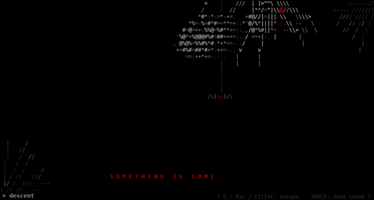

# ARACHNE

A cinematic ASCII horror spider that stalks you through the command line.

A huge black, white and blood-red spider crawls through the darkness of your terminal. It has eight long, angular legs, a shaded and segmented body, fangs and glowing red eyes. Webs grow behind it, smaller spiders scuttle past, and messages type themselves out in red. The tension builds until it finds you.



## Run it

You need Python 3.8 or newer. There is nothing to install: it uses only the standard library.

**Windows (CMD or Windows Terminal)**

1. Install Python from [python.org](https://www.python.org/downloads/) and tick **"Add python.exe to PATH"** during setup.
2. Open the folder that contains `spider.py` in File Explorer, type `cmd` in the address bar and press Enter.
3. Run `python spider.py` (or `py spider.py`).

**macOS (Terminal or iTerm2)**

```sh
python3 ~/Downloads/spider.py
```

If macOS offers to install the command line developer tools, accept. To launch it without typing `python3`, run `chmod +x spider.py` once.

**Linux**

```sh
python3 spider.py
```

For the full effect, go full screen (F11 in Windows Terminal, Ctrl+Cmd+F on a Mac) and turn the lights off.

## Controls

| Key | Action |
| --- | --- |
| `Space` | Play the next sequence right away |
| `Q`, `Esc` or `Ctrl+C` | Quit. Your terminal is restored as it was |

## Options

| Option | Effect |
| --- | --- |
| `--demo` | Play every sequence back to back |
| `--scene NAME` | Start with one sequence: `descent`, `eyes`, `swarm`, `glass`, `mother`, `cocoon` or `heartbeat` |
| `--no-flash` | No red screen flashes (use this if you are sensitive to flashing light) |
| `--fps 30` | Smoother animation, a little more CPU (default 20) |
| `--seed 7` | Replay the same "random" show |

## The sequences

- **descent**: it lowers itself from the ceiling on a thread, turning slowly, then drops.
- **eyes**: the lights go out and dozens of red eyes open in the dark... then it is right in front of you.
- **swarm**: small spiders pour in from every edge, crawl over everything, then flee.
- **glass**: it hits the screen so hard the glass cracks.
- **mother**: something enormous crawls past in the background.
- **cocoon**: a web is spun across the whole screen. It waits at the centre, then tears through.
- **heartbeat**: it stares at you while a heartbeat speeds up. Silence. Then it jumps.

Between sequences, the spider has a life of its own. It crawls, pauses, twitches, rears up with its front legs raised, lunges at the screen, sinks into the dark and reappears elsewhere. Every couple of minutes it builds to a climax.

## How it works

- **The spider** is a small 3D model rendered in ASCII. Its body is lit, ray-traced ellipsoids; its legs use inverse kinematics; it walks with an alternating gait; a depth buffer handles overlaps.
- **Rendering** uses ANSI escape codes. Each frame, only the characters that changed are redrawn, so the screen doesn't flicker and CPU use stays low.
- **The window size** is detected continuously, so the animation always fits the visible screen.

## Safety

ARACHNE is purely visual. It never reads or writes files, runs commands, touches other programs or uses the network. Colours, cursor and the previous screen content are restored when it exits, including after `Ctrl+C`.

It contains occasional brief red flashes unless started with `--no-flash`.
